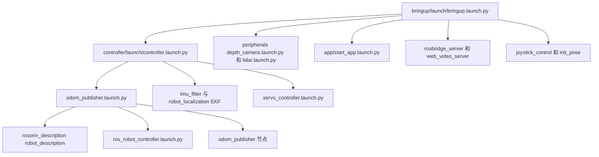
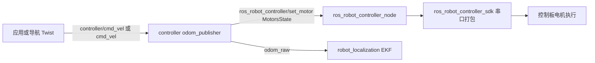
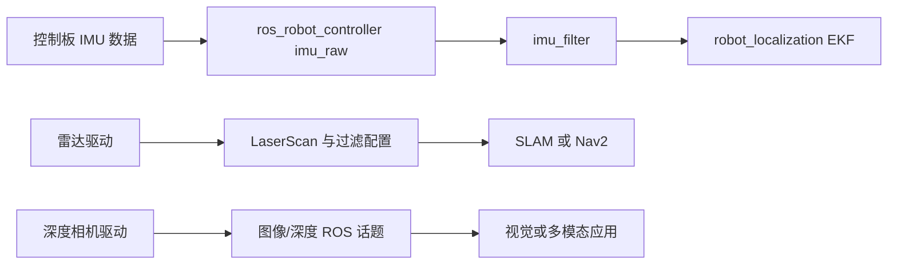
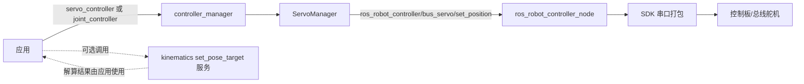
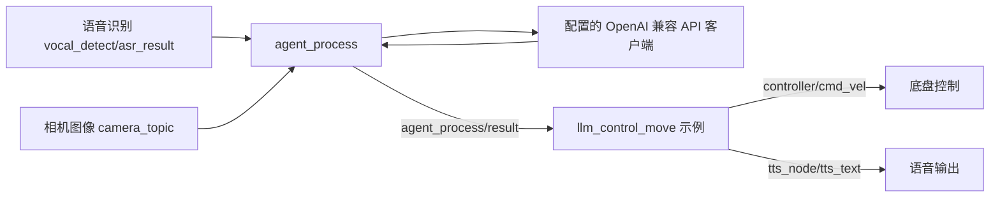

# 核心调用关系与复用分析（静态阅读）

基于官方 commit `6c2a621fe628cc4928c48fc11d8d982594d471eb`。以下路径均相对于 `ROS2/src_ros2/src/`，箭头是源码中明确的启动、话题或服务关系；并非实机运行验证。运行时命名空间、条件和参数可能改变最终名称。

## 启动关系

以上是 launch 包含关系，不代表启动完成的严格先后次序。`need_compile`、`MACHINE_TYPE` 等环境变量及实际包安装影响执行；若 `need_compile` 不为 True，多处写死 `/home/ubuntu/ros2_ws/src/...`。证据：`bringup/launch/bringup.launch.py`、`driver/controller/launch/controller.launch.py`、`driver/controller/launch/odom_publisher.launch.py`。

## 底盘与 STM32

`odom_publisher_node.py` 还订阅 `app/cmd_vel`，底盘类型和运动学按程序配置；SDK 使用 `serial.Serial`、`buf_write`、`port.write` 发送电机及舵机包。软件中里程计由节点速度量积分计算，不能据此断言实测编码器闭环或定位精度；请结合硬件实测。源码：`driver/controller/controller/odom_publisher_node.py`、`driver/controller/controller/mecanum.py`、`driver/ros_robot_controller/ros_robot_controller/ros_robot_controller_node.py`、`ros_robot_controller_sdk.py`。SDK 的板端对应固件为仓库中的 STM32 HEX，非完整 STM32 固件源码。

## 传感器数据流

证据：`driver/ros_robot_controller/ros_robot_controller/ros_robot_controller_node.py`、`driver/controller/launch/controller.launch.py`、`peripherals/launch/lidar.launch.py`、`peripherals/launch/depth_camera.launch.py`。雷达及相机的具体驱动、话题、滤波器依启动条件与实际安装设备确认；无需假定所有传感器都连接 STM32。

## 机械臂和舵机

证据：`driver/servo_controller/servo_controller/controller_manager.py`、`servo_controller.py`、`driver/kinematics/kinematics/search_kinematics_solutions_node.py`、`kinematics_control.py`。运动学目录含 `forward_kinematics.so`、`inverse_kinematics.so`，本次快照提供二进制，未见对应实现源码；只能确认源码缺失，不能仅凭此断言授权或开发商闭源政策。架构兼容性和可运行性待验证。

## AI 和语音

证据：`large_models/large_models/large_models/agent_process.py`、`large_models_examples/large_models_examples/llm_control_move.py`。API 地址和模型可配置，不能推断默认一定本地离线；语音、模型配置、网络、认证及安全隔离均需另行验证。`openclaw_controller/voice_openclaw.py` 另外调用 OpenClawClient、FeishuSender，订阅识别结果与播放完成事件，它不是全部 AI 示例的必经环节。

## SLAM、导航及外部依赖

`slam/launch/slam.launch.py` 默认 `slam_toolbox` 并支持其他分支，包括 Cartographer；`navigation/launch/include/localization.launch.py` 调用 Nav2 map server、AMCL，`navigation_base.launch.py` 加载 Nav2 控制、规划、行为等组件。具体版本、驱动与 ROS 发行版需在目标设备检查。`xf_mic_asr_offline/lib` 带有 x64/arm64 二进制 `libmsc.so`、`liboffline_record_lib.so` 等，具体来源、源代码和兼容性待核实，不宜视作自有可维护实现。官方环境路径依赖 `~/ros2_ws` 和部分系统服务，第三方包如 `robot_localization`、`cartographer_ros`、Nav2、相机/雷达驱动及 speech 等是否另装应以对应 package.xml、launch 与实机环境确认，不能假称全部包含在仓库。复用源码前应核对设备协议、机械参数、话题、依赖及软硬件安全；以上全为静态分析，未编译、未部署、未实机运行。

## 具体检查点

- `driver/servo_controller/launch/servo_controller.launch.py` 的 `need_compile=True` 分支调用 `get_package_share_directory`，该文件当前未见相应 import；该分支是否报 NameError 应在 ROS 环境验证。
- 串口、舵机及速度控制会驱动真实硬件。首轮移植应使用仿真、限速和急停，并验证命名空间、硬件协议和反馈。
- `odom_publisher_node.py` 中 `cal_odom_fun` 位置积分只使用 `linear_x` 和航向，而速度消息还包含 `linear_y`；麦克纳姆横移时该位置估计可能遗漏横向位移，需要结合目标版本和实机验证。
- `servo_controller/servo_controller/servo_controller.py` 的 `get_servo_id` 使用 `GetBusServoStateRequest`，文件中未见该名称导入；该函数路径是否可达和实际影响待测试。
