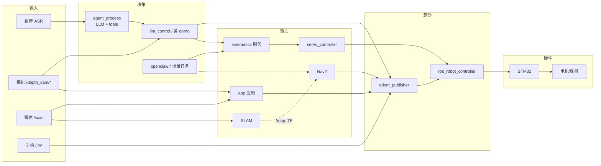
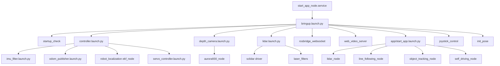
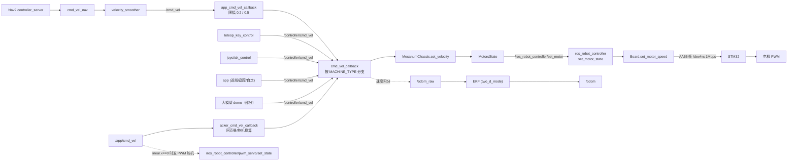
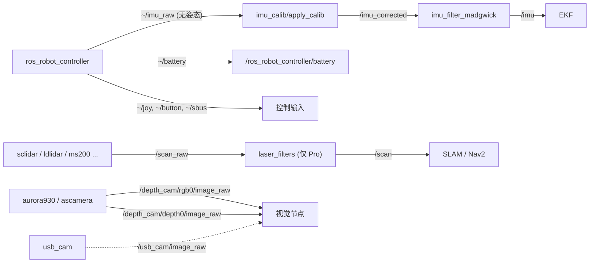
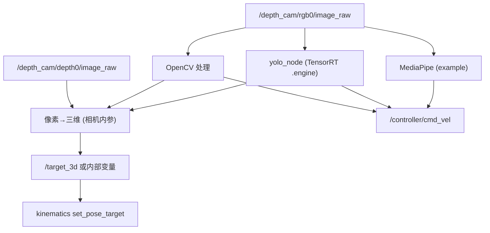
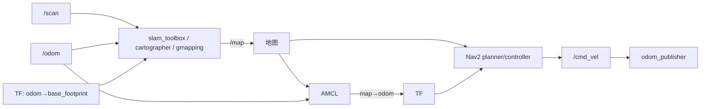
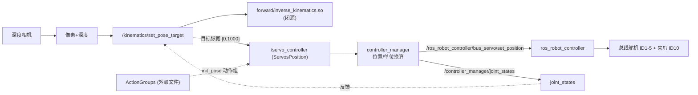
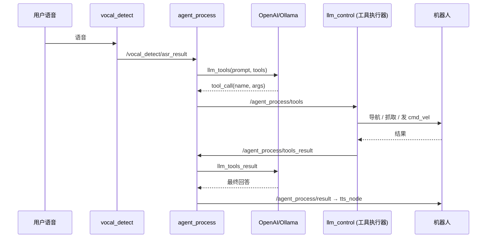

# 模块关系（Mermaid）

> 实线 = 源码中可验证的连接（A/B 级证据）；虚线 = 由配置或命名推断（C 级），需实机确认。

## 1. 整体模块架构

## 2. 启动关系

## 3. 底盘控制

## 4. 传感器数据流

> `/scan` 只在 `MACHINE_TYPE` 含 `Pro` 时经过 laser_filters（`lidar.launch.py:42-77`）；
> 非 Pro 机型直接是驱动输出。

## 5. 视觉识别

> 原厂**没有统一的三维目标话题**：各 Demo 各自把 `(u,v,depth)` 换算后直接调服务或发速度。

## 6. SLAM 与导航

## 7. 机械臂

## 8. AI 任务调用

> 这条链是**真实的**：工具有真实实现（`function_calling/llm_control.py` 中 `move_to_location`、
> `get_pixel_distance` 等）。但工具集合是**每个 Demo 硬编码**的，不是通用能力；
> 且执行器可以直接发 `/controller/cmd_vel`，没有安全层。
