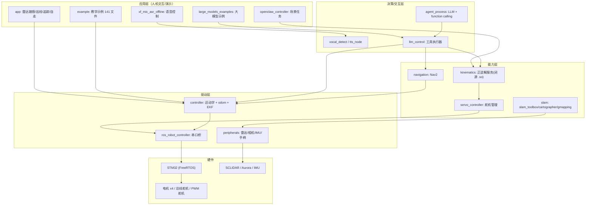

# 软件架构

## 1. 分层



实线均为源码中可验证的调用/话题关系；L4→L1 的交叉调用是原厂风格（应用层直接发 cmd_vel），不是分层设计。

## 2. 包职责与依赖

| 包 | 类型 | 职责 | 关键依赖 |
|---|---|---|---|
| `bringup` | 启动 | 总 launch + 开机自检 | controller/peripherals/app |
| `controller` | 驱动 | 运动学、odom、EKF、初始位姿 | ros_robot_controller_msgs、robot_localization |
| `ros_robot_controller` | 驱动 | 串口协议、IMU/电池/按键/舵机 | pyserial、ros_robot_controller_msgs |
| `peripherals` | 驱动 | 雷达/相机/IMU 滤波/手柄/键盘 | 各雷达与相机厂商包、laser_filters |
| `servo_controller` | 驱动 | 舵机位置管理、joint_states | ros_robot_controller_msgs、control_msgs |
| `kinematics` | 能力 | 机械臂 IK/FK 服务 | **闭源 .so**、kinematics_msgs |
| `navigation` | 能力 | Nav2 参数与 launch | nav2_* |
| `slam` | 能力 | 3 种 SLAM + rrt_explorer | slam_toolbox、cartographer、gmapping |
| `app` | 应用 | 雷达避障/跟随/警卫、巡线、目标追踪 | OpenCV、interfaces |
| `large_models` | 应用 | Asr→LLM→Tools 调度、TTS | `speech`（**不在仓库**） |
| `openclaw_controller` | 应用 | 底盘/机械臂/导航/抓取技能 | kinematics、servo_controller |
| `simulations/rosorin_description` | 模型 | URDF/xacro/mesh + RViz | 源码包内无 Gazebo launch（Gazebo 包在教程资源 `simulations.zip`） |
| `multi` / `test_stand` / `calibration` / `example` | 辅助 | 多机、测试架、标定、教学 | — |

## 3. 数据流分层

### 3.1 控制下行

```
Nav2 controller_server → cmd_vel_nav → velocity_smoother → /cmd_vel
                                                              │
                                                    app_cmd_vel_callback
                                                    （限幅 0.2 m/s / 0.5 rad/s）
                                                              │
遥控/键盘/app/大模型 ────────────────────────► /controller/cmd_vel
                                                              │
                                                    cmd_vel_callback
                                                    （按 MACHINE_TYPE 分支）
                                                              ▲
                             /app/cmd_vel ─► acker_cmd_vel_callback
                                             （换算后才进 cmd_vel_callback）
                                                              │
                                      MecanumChassis/AckermannChassis.set_velocity
                                                              │
                                              MotorsState → /ros_robot_controller/set_motor
                                                              │
                                     ros_robot_controller_node.set_motor_state
                                                              │
                                    Board.set_motor_speed → 串口 AA 55 … CRC8
                                                              │
                                                       STM32 → 电机
```

### 3.2 状态上行

```
STM32 → Board.recv_task（AA55 解析） → 各 queue
      → ros_robot_controller_node.pub_callback（50 Hz 线程）
      → /ros_robot_controller/{imu_raw,battery,button,joy,sbus}
      → imu_calib → imu_filter_madgwick → /imu
      → odom_publisher（速度积分）→ /odom_raw
      → robot_localization EKF（odom0=odom_raw, imu0=imu, two_d_mode）
      → /odom
```

## 4. 两个"名义 vs 实际"的差异

| 名义 | 实际 |
|---|---|
| `driver/sdk` 是"机器人 SDK" | 实际是通用工具包（`common.py` 图像/数学、`fps.py`、`led.py`、第三方 `pid.py`），**与 STM32 无关** |
| `servo_controller` 节点的名字 | launch 里 executable 叫 `servo_controller`，但代码构造时命名为 `controller_manager`（`controller_manager.py:116`），所以话题是 `/controller_manager/*` |

## 5. 与课题组 lab_ws 的接口边界

可直接复用：`controller`（运动学+odom）、`ros_robot_controller`、`servo_controller`、`peripherals` 的雷达/相机。
不建议复用：`app`、`bringup`、`large_models*`、`openclaw_controller`（应用层，直接抢底盘）。
必须重写：控制源仲裁、安全监督、任务编排（见 `06_reuse_guide/source_reuse_guide.md`）。
