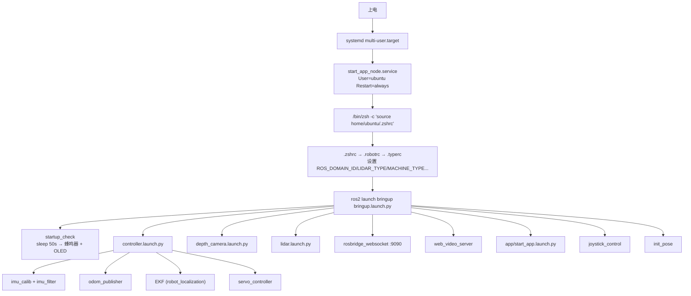

# 启动流程

## 1. 总览



## 2. 逐段证据

### 2.1 systemd

`src/bringup/scripts/start_app_node.service`：

```ini
After=NetworkManager.service time-sync.target
Type=simple
User=ubuntu
Restart=always
RestartSec=30
ExecStart=/bin/zsh -c 'source home/ubuntu/.zshrc; ros2 launch bringup bringup.launch.py;'
```

两个可验证的问题：

1. `home/ubuntu/.zshrc` **缺少前导 `/`**。systemd 默认工作目录是 `/`，所以恰好能解析；
   一旦有人加了 `WorkingDirectory=`，这条就会失效。
2. `Restart=always` 会掩盖启动失败：进程崩了 30 秒后重来，`systemctl status`
   只能看到重启计数，看不到"从未成功"。

### 2.2 Shell 环境

`.robotrc` 做四件事：source `.typerc`、设置 CUDA 与 PATH、**叠加 7 个工作空间**、设置
`ROS_DOMAIN_ID=113` 与 `CYCLONEDDS_URI`。

`.typerc` 提供 `LIDAR_TYPE=SCLIDAR`、`DEPTH_CAMERA_TYPE=aurora`、`MACHINE_TYPE=ROSOrin_Mecanum_Pro`、
`need_compile=False` 等。**这些变量是 launch 的硬依赖**：`lidar.launch.py:12-14`、
`depth_camera.launch.py:12`、`odom_publisher_node.py:94` 直接 `os.environ[...]`，缺失即 KeyError。

### 2.3 bringup 展开

`src/bringup/launch/bringup.launch.py:71-81` 返回 9 个动作：

| 顺序 | 动作 | 实际内容 |
|---|---|---|
| 1 | `startup_check` | 阻塞线程 `time.sleep(50)`，之后蜂鸣器 + OLED 显示 SSID/IP（`startup_check.py:54`） |
| 2 | `controller.launch.py` | imu_filter、odom_publisher、EKF、servo_controller |
| 3 | `depth_camera.launch.py` | 按 `DEPTH_CAMERA_TYPE` 选 ascamera/aurora/usb_cam |
| 4 | `lidar.launch.py` | 按 `LIDAR_TYPE` 选驱动，Pro 机型加 laser_filters |
| 5 | `rosbridge_websocket` | 9090，网页/APP 通信 |
| 6 | `web_video_server` | 浏览器看视频流 |
| 7 | `start_app.launch.py` | lidar/line_following/object_tracking/self_driving 四个应用节点 |
| 8 | `joystick_control` | 手柄 → `/controller/cmd_vel` |
| 9 | `init_pose` | 机械臂回初始位姿（读 `/home/ubuntu/software/arm_pc/ActionGroups`） |

### 2.4 controller 展开

`src/driver/controller/launch/controller.launch.py`：

1. `imu_filter.launch.py`：`imu_calib/apply_calib` + `imu_filter_madgwick`
   （`raw ← /ros_robot_controller/imu_raw`，`imu/data → imu`）
2. `odom_publisher.launch.py`：`controller:odom_publisher`
3. `robot_localization/ekf_node`：`odometry/filtered → odom`，`cmd_vel → controller/cmd_vel`（只订阅）
4. `servo_controller.launch.py`：`servo_controller:servo_controller`（节点实际名为 `controller_manager`）

## 3. 时间线

| 相对时间 | 事件 | 证据 |
|---|---|---|
| T+0 | systemd 启动服务 | 单元文件 |
| T+~1s | zsh 加载环境，launch 解析 | `.robotrc` |
| T+~2s | 各驱动节点并行拉起（串口/相机/雷达初始化） | 各 launch |
| T+50s | `startup_check` 蜂鸣 + OLED | `startup_check.py:54` |
| 独立流程 | 导航启动后 **10 秒**才起 Nav2 | `navigation.launch.py:60-63` |
| 独立流程 | SLAM 启动后 **10 秒**才起 SLAM 节点 | `slam.launch.py` TimerAction |

> 结论：**原厂没有任何"就绪判定"**。50 秒是硬编码等待，节点是否真的起来了无人检查。
> 这也是开机后"有时能用有时不能用"的典型来源。

## 4. 退出与异常

* `odom_publisher` 注册了 `SIGINT` → `rclpy.shutdown()`（`odom_publisher_node.py:84,147`）。
* `ros_robot_controller` 在 KeyboardInterrupt 时下发 4 个电机 0 速（`ros_robot_controller_node.py:364-368`）——
  **只在正常退出时**，kill -9 或断电不会执行。
* 其他节点无退出清理。

## 5. 对二次开发的含义

1. 不要依赖"开机 50 秒后即可用"，要用话题频率/服务可用性做就绪判断。
2. `need_compile=False` 时所有 launch 走 `/home/ubuntu/ros2_ws/src/...` 源码路径，
   修改源码立即生效、`install/` 可能是旧快照。
3. 若要让 lab_ws 接管，必须先把 `start_app_node.service` 停掉并禁用，
   否则两套系统会同时抢 `/controller/cmd_vel`（见 `04_module_analysis/safety.md`）。
