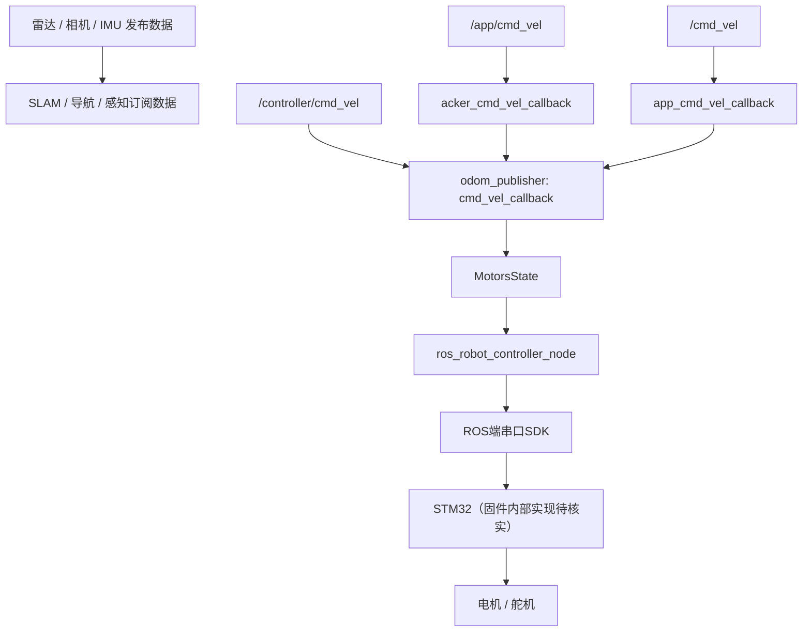

# 系统总览

> 证据等级：A/B（文件级事实来自源码解析，见 `01_source_index/`）。
> 统计口径：本地 `src_ros2-main.zip` 快照，998 个文件（含 5 个仓库根文件）。

## 1. 规模

| 项 | 数值 | 说明 |
|---|---|---|
| ROS 2 功能包 | 25 | `package.xml` 全量计数 |
| 文件总数 | 998 | 含隐藏文件 |
| Python | 294 个 / 2.23 MB | 另有 152 个 `*.launch.py` 含在其中 |
| Launch | 152 | 各包 `launch/` 83 + 示例包 54 + 其他 15 |
| 接口定义 | 72（38 msg + 34 srv） | 另有 0 个 action（全仓库无 `.action`） |
| 动态库 | 7 | 机械臂运动学 2 + 讯飞语音 5 |
| C/C++ 源码 | 1 个 .cpp + 16 个 .h | **全部属于讯飞语音 SDK**，不是 STM32 工程 |
| 资源总量 | 782 MB | 网格/音频/模型占绝大部分 |

## 2. 代码来源分类

| 类别 | 位置 | 说明 |
|---|---|---|
| 原厂自研 | `driver/`、`peripherals/`、`navigation/`、`slam/`、`app/`、`bringup/`、`large_models*/`、`openclaw_controller/` | 主体，Python 为主 |
| 第三方开源 | `driver/sdk/sdk/pid.py`（Ivmech PID）、`xf_mic_asr_offline/include/*.h`（讯飞） | 少量 |
| 闭源二进制 | `driver/kinematics/kinematics/*.so` | **正/逆运动学无源码** |
| 商业 SDK 库 | `xf_mic_asr_offline/lib/{arm64,x64}/*.so` | 讯飞离线语音 |
| 模型文件 | `example/example/yolo_detect/models/*.engine`、`app/app/model/*.onnx`、`nanotrack` | 不可读 |
| 教学示例 | `example/`（141 个文件）、`large_models_examples/`（106） | 与产品功能并存 |

## 3. 系统由什么组成

下面是**根据已检查代码整理的逻辑消息流**；各外部驱动和条件分支均需按本地源码与实机配置核实。



**注意：** 上图中三个`cmd_vel`均为**发布者输出到订阅者的消息方向**，不表示任何发布者都经过同一限幅逻辑；阿克曼相关回调和主回调还可能单独输出舵机指令。

## 4. 三个必须知道的事实

### 4.1 底盘有 3 个控制入口，且互不仲裁

`src/driver/controller/controller/odom_publisher_node.py:136-138`：

```python
self.create_subscription(Twist, 'controller/cmd_vel', self.cmd_vel_callback, 1)
self.create_subscription(Twist, 'app/cmd_vel',      self.acker_cmd_vel_callback, 1)
self.create_subscription(Twist, 'cmd_vel',          self.app_cmd_vel_callback, 1)
```

三个入口对应**三个不同回调**（不是同一个）：

| 话题 | 回调 | 行为 |
|---|---|---|
| `/controller/cmd_vel` | `cmd_vel_callback`（L216） | 遥控、teleop、app 巡线/追踪、大模型示例都发这里，**不限速** |
| `/app/cmd_vel` | `acker_cmd_vel_callback`（L200） | 先做阿克曼/舵机换算；`linear.x==0` 时会发 PWM 舵机 1 号 |
| `/cmd_vel` | `app_cmd_vel_callback`（L185） | 先限幅到 ±0.2 m/s、±0.5 rad/s，再转给 `cmd_vel_callback` |

* `/cmd_vel` 是**Nav2 的 velocity_smoother 输出**（`navigation/launch/include/navigation_base.launch.py`：`cmd_vel_smoothed → cmd_vel`）。
* 三个入口最终都落到 `cmd_vel_callback`，但**限幅/换算只发生在后两个入口**。
* 谁最后发谁生效，没有优先级、没有超时。

> 上一版把三条线都画进 `cmd_vel_callback`，已修正；详见 `04_module_analysis/motion.md` §1。

### 4.2 AI 能力的落点要按接口分类，不能一概而论

只有部分 Demo 直接发 `cmd_vel`。按实际接口分：

* **直接底盘速度**：`llm_control_move.py:113,183`（`eval` 解析后发 `/controller/cmd_vel`）；
* **Nav2 导航**：`vllm_navigation.py` 等通过 `navigation_controller/set_pose`；
* **机械臂**：`vllm_track_arm.py` 等发 `/servo_controller` 并调 `/kinematics/set_pose_target`；
* **只生成文本/工具调用**：`large_models` 核心包（`agent_process.py`）没有任何底盘/舵机发布者。

完整七类划分见 `04_module_analysis/ai.md`。

### 4.3 机械臂运动学是二进制

`kinematics/kinematics/forward_kinematics.so`（1.0 MB）与 `inverse_kinematics.so`（0.75 MB）
被 `search_kinematics_solutions_node.py:16-17` 直接 `import`，**无法阅读实现**。
能看到的只有：关节链参数（`transform.py`）、服务接口（`kinematics_msgs/srv/*`）、脉宽范围 0–1000。

## 5. 这个系统不是什么

* 不是"一个统一架构"：产品功能、教学示例、大模型 Demo 三套代码并存，风格与接口不统一。
* 已检查的AI示例并不能证明具备通用任务规划、持久状态管理和失败恢复；部分Demo具备预设工具调用和多步处理，不应一概否定其有限自主能力。
* 不是"开源可复现"：运动学 .so、语音 .so、`speech` pip 包、`/home/ubuntu/software/` 下的资源都不在仓库内。
* 尚不能证明具有完整的统一安全层：已检查的Jetson ROS 2代码范围未发现软件急停、指令超时和控制源仲裁；
  STM32 层有舵机保护配置接口但默认状态未知；硬件层有无物理急停无法从资料判断
  （详见 `04_module_analysis/safety.md` 的分层结论）。

## 6. 版本基线（必须与统计一起引用）

| 项 | 本地交付包 | GitHub `orin-nx@6c2a621` |
|---|---|---|
| 文件数 | 998 | 未全量比对（抽样 78 个：58 同 / 12 异 / 8 无法访问） |
| `command` | 604 行 | 310 行 |
| `ROS_DOMAIN_ID` | 113 | 56 |
| `ASR_LANGUAGE` | English | Chinese |
| `VERSION` | 2026-06-01 | 2026-02-02 |

**本资料包以本地交付包为准**；GitHub 仅用于提供可点击链接，链接内容可能与本包不同。

### V1.2核对注意

已将原文本结构图改为Mermaid消息流图，修正将订阅关系误写成节点向话题发送消息的问题。各边仍属静态分析摘要，实机话题连通性未验证。
