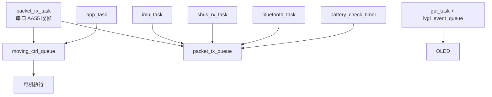

# STM32 分析

> 本文件重写。上一版只查了 `src_ros2-main.zip` 就下"厂家没有 STM32 工程"的结论，**范围不足**。
> 本次扫描了**整个百度网盘交付目录**（`ROSOrin Pro智能小车(Orin NX)\`），结论如下。

## 1. 交付物盘点（全目录扫描）

扫描范围：`D:\BaiduNetdiskDownload\ROSOrin Pro智能小车(Orin NX)\`（1 教程资料 / 2 软件工具 / 3 源码资料 / 4 硬件资料 / 5 系统镜像 / 6 虚拟主机 / 8 无主控安装）。

| 查找项 | 结果 | 说明 |
|---|---|---|
| `.c` / `.cpp` / `.h` / `.hpp` | **0 个** | 全目录无 C/C++ 源文件 |
| Keil/IAR 工程（`.uvprojx`/`.uvproj`/`.ewp`） | **0 个** | — |
| STM32CubeMX（`.ioc`） | **0 个** | — |
| HEX 固件 | **1 个** | `3 源码资料/STM32/RosRobotControllerM4-20260414.hex`（184 KB） |
| 协议文档（RRC/串口协议） | **0 个本地文件** | 只有指向网盘的 `.html` 链接 |
| 压缩包 | 7 个 `.rar`（系统镜像分卷）+ 7 个 `.zip`（工具/课程资源） | 逐个核对，**无 STM32 工程包** |

### 关键：STM32 资料是"链接"，不是"文件"

`4 硬件资料/` 下只有 6 个 0.4 KB 的 HTML，内容是百度网盘跳转链接：

| 链接文件 | 指向 | 提取码 |
|---|---|---|
| `请先下载此链接...STM32机器人控制器 资料` | 网盘（未下载） | `vy7s` |
| `开发基础课程/...MiniSTM32机器人控制器 资料` | 网盘（未下载） | `pfvg` |
| `编码电机资料` / `总线舵机资料` / `屏幕资料` / `ROS主控资料` | 网盘（未下载） | 各自不同 |

**因此准确结论是**：

1. 本地已下载的交付目录里**没有** STM32 源码工程；
2. 厂家资料入口**存在**，但对应文件未下载，**不能据此断定厂家不提供**；
3. 要判定"是否有完整工程"，必须按上面链接下载后再查（或直接向厂家索取）。

## 2. HEX 静态分析（A 级，仅限可验证部分）

| 项 | 值 |
|---|---|
| 文件 | `RosRobotControllerM4-20260414.hex` |
| 大小 / 行数 | 188,602 字节 / 4,194 行 |
| 记录类型 | 数据 4,190；扩展线性地址 2；起始地址 1；EOF 1 |
| **校验错误** | **0** |
| 有效镜像 | 67,032 字节，连续 |
| 地址范围 | `0x08000000 – 0x080105D7` |
| 起始地址 | `0x08000189`（奇数 → Thumb） |

### 向量表（前 8 字节）

```
68 82 01 20  →  初始 SP   = 0x20018268
41 02 00 08  →  Reset    = 0x08000241
```

SP ≈ 96.6 KB，符合 STM32F4 系列 SRAM 布局（C 级推断）；复位向量位于 Flash 起始附近，
符合标准启动文件布局。

### 字符串证据（A 级）

镜像中 217 个可打印字符串，21 个与固件结构相关：

```
任务：app_task / defaultTask / gui_task / imu_task / oled_task /
      packet_rx_task / packet_tx_task / sbus_rx_task / bluetooth_task
队列：USBH_Queue / packet_tx_queue / moving_ctrl_queue / bluetooth_tx_queue /
      buzzer1_ctrl_quque / led1_ctrl_quque / lvgl_event_queue
同步：oled_mutex / serial_servo_rx_complete
定时：battery_check_timer / buzzer_timer / led_timer
```

（`quque` 是固件里的原始拼写。）

由字符串可推断的固件结构（C 级）：



要点：

* 电机指令走**队列**（收帧与执行解耦）；
* 总线舵机是半双工，`serial_servo_rx_complete` 表明要等回包；
* 屏幕 UI（LVGL）跑在 STM32，不在 Jetson；
* **没有** `watchdog` / `estop` / `timeout` 一类字符串——不能据此断定没有，但也没有正面证据。

## 3. 与 Jetson SDK 的交叉核对（B 级）

| SDK 函数（`ros_robot_controller_sdk.py`） | 帧 | STM32 侧（字符串推断） | 一致性 |
|---|---|---|---|
| `set_motor_speed` | FUNC=3, sub=0x01, `<Bf`(id-1, rps) | `moving_ctrl_queue` | ✅ |
| `pwm_servo_set_position` / `set_offset` | FUNC=4, sub=0x03 / 0x07 | PWM 舵机（转向） | ✅ |
| `bus_servo_set_position` 等 | FUNC=5 | `serial_servo_rx_complete` | ✅ |
| `get_imu` | FUNC=7 上报 6×float32 | `imu_task` | ✅ |
| `get_battery` | FUNC=0, sub=0x04, `<H` | `battery_check_timer` | ✅ |
| `get_button` | FUNC=6 | 按键扫描 | ✅ |
| `get_gamepad` / `get_sbus` | FUNC=8 / 9 | `sbus_rx_task`、USB 手柄 | ✅ |
| `set_oled_text` | FUNC=10 | `gui_task` + LVGL | ✅ |
| `set_led` / `set_buzzer` | FUNC=1 / 2 | `led_timer` / `buzzer_timer` | ✅ |

功能码与固件内部任务一一对应，说明 SDK 与这版固件配套。

## 4. STM32 层可确认 / 不可确认

### 可以确认（有直接证据）

1. 固件是合法 Intel HEX，镜像完整、无校验错误；
2. 运行 FreeRTOS，具备上表 9 个任务；
3. 电机、舵机、IMU、电池、按键、手柄、SBUS、OLED 都有对应处理路径；
4. 支持总线舵机的角度/电压/温度/扭矩**配置接口**（Jetson SDK 侧函数齐全）。

### 无法确认（D 级）

| 问题 | 原因 |
|---|---|
| 电机 PID 参数、闭环频率 | 需读代码，HEX 无法定位 |
| 是否读取编码器、如何算轮速 | 同上 |
| 是否有指令超时/看门狗 | 字符串无迹象，但不能反证 |
| 电池采样与保护阈值 | `set_battery_level` 默认 0x2904=10500，仅暗示 mV |
| 蓝牙用途 | 只有 `bluetooth_task` 字符串 |
| 固件版本/编译时间 | 文件名含 `20260414`，镜像内未见版本串 |

## 5. 结论

> 本地交付目录**没有 STM32 源码工程**，只有 HEX；
> 厂家资料入口（网盘链接）存在但未下载，**不能判定厂家是否提供源码**；
> HEX 可证明固件结构（FreeRTOS + 9 任务 + 12 功能码），**不能恢复原始程序**。

给课题组的建议：

1. 先按 `vy7s` 提取码把 STM32 资料下载下来，再更新本节；
2. 在拿到源码前，把 STM32 当黑盒，只依赖已验证的 12 个功能码；
3. 安全兜底必须做在 Jetson 侧（固件是否有看门狗未知）。

## V1.2补充：压缩资料覆盖限制

此前“本地已下载资料未找到STM32工程”的结论只适用于当时**已展开/可扫描的可见文件范围**。据Work复审，7个RAR分卷和ZIP中的嵌套压缩文件未全部展开；不能据此断言所有本地压缩资料中都没有C/C++工程。HEX中字符串只能证明字符串存在，不能独立证明FreeRTOS任务执行、固件功能码与SDK完全配套、保护机制实际启用。相关内容继续标记待核实。
