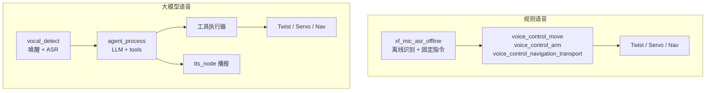

# ai · AI 与自主决策

> 本文件重写：不再把"AI 程序"笼统写成"直接发 cmd_vel"。
> 按**实际 ROS 接口**把 AI 相关代码分成 7 类，并区分"生成文本 / 生成工具调用 / 调用 ROS / 硬件执行"四层。
> 版本提示：`agent_process.py` 与 `function_calling/llm_control.py` 在本地快照与 GitHub `orin-nx@6c2a621` **内容不同**（见 README §9）。

## 1. 四层证据链

| 层 | 谁做 | 可验证产物 | 证据 |
|---|---|---|---|
| ① 文本生成 | LLM（OpenAI 兼容 / Ollama） | 自然语言回答 | `agent_process.py:336,361` |
| ② 结构化工具调用 | LLM + tool schema | `Tools{id,name,data}` | `agent_process.py:342-348` |
| ③ 调用 ROS 接口 | 工具执行器（Python） | 话题/服务/动作调用 | `function_calling/llm_control.py:461-521` |
| ④ 硬件执行 | 原厂驱动 | 电机/舵机动作 | `ros_robot_controller` → STM32 |

**只有 ③④ 两层才动机器人。** 单纯对话（①）不产生任何动作；
②只是 JSON，若没有执行器订阅 `agent_process/tools`，机器人不会有反应。

## 2. 七类功能与实际源码

| # | 功能类型 | 代表文件 | ROS 接口 | 是否有本地源码 |
|---|---|---|---|---|
| 1 | **直接底盘速度** | `llm_control_move.py`、`llm_control_move_offline.py`、`apritag_control.py`、`automatic_transport.py`、`voice_control_move.py`、`claw_move_control.py` | 发布 `/controller/cmd_vel`（Twist） | ✅ |
| 2 | **Nav2 导航** | `vllm_navigation.py`、`vllm_navigation_transport.py`、`function_calling/llm_control.py`、`road_network_tool.py`、`smart_logistics_tool.py`、`voice_control_navigation_transport.py` | 多种接口，`voice_control_navigation_transport.py`使用 `/navigation_transport/pick`；其他导航程序可能调用 `navigation_controller/set_pose` → Nav2 | ✅ |
| 3 | **机械臂** | `vllm_track_arm.py`、`object_transport.py`、`waste_classification.py`、`claw_track_and_grab.py`、`claw_arm_group_control.py`、`voice_control_arm.py` | 发布 `/servo_controller`；调 `/kinematics/set_pose_target` | ✅ |
| 4 | **视觉识别/跟踪** | `vllm_track.py`、`vllm_with_camera.py`、`llm_color_track.py`、`llm_visual_patrol.py` | 订阅 `/depth_cam/rgb0/image_raw`；发布 Twist 或调用 VLM 服务 | ✅ |
| 5 | **Function Calling** | `function_calling/llm_control.py`（1189 行，定义 10+ 工具） | 订阅 `agent_process/tools`，回发 `tools_result` | ✅ |
| 6 | **任务分解/工具调度** | `large_models/agent_process.py` | 发布 `~/tools`、`~/result`；服务 `~/set_tool`、`~/set_model` | ✅ |
| 7 | **语音识别/指令传递** | `xf_mic_asr_offline`（规则式）；`vocal_detect.py`（LLM 链路前端） | `/vocal_detect/asr_result`、`/vocal_detect/wakeup` | ✅ |

### 关键区分

* `large_models`（核心包，64 个文件）**在已检查路径未发现 cmd_vel / servo / nav 客户端**——
  在已检查的`agent_process`等路径中主要负责文本与工具调用。该判断只限已检查代码，不等于整个包经全量审计。
* 机器人接口还存在于 `large_models_examples`（V1.1统计106个文件，其中25个带机器人接口）、`openclaw_controller`（V1.1统计42个文件）以及 `xf_mic_asr_offline` 的语音控制程序；不能说动作执行全部位于前两个包。各节点是否在实机启动或驱动硬件，未核实。
* `xf_mic_asr_offline` 是**规则语音**（离线识别 + 固定指令表），与 LLM 链路并行，不是同一套。

## 3. 两种执行器模式

### 3.1 文本解析式（简单 Demo）

`llm_control_move.py:164-188`：

```python
result = eval(self.llm_result[...])          # L169：eval 模型输出
for i in result['action']:
    msg.linear.x, msg.linear.y, msg.angular.z = float(i[0]), float(i[1]), float(i[2])
    self.mecanum_pub.publish(msg)            # L183：直接发 /controller/cmd_vel
    time.sleep(i[3])
```

* 模型只输出一段 JSON 文本，程序 `eval` 后当动作列表执行；
* 无 schema 校验、无限幅、无超时；
* 属"文本→动作映射"，不是工具调用。

### 3.2 工具调用式（function calling）

`function_calling/llm_control.py`：

| 步骤 | 代码 | 说明 |
|---|---|---|
| 注册工具 | `tools = [...]` L49 起 | 每个工具带 JSON schema |
| 注入模型 | `agent_process/set_tool`（L461） | 由执行器告诉模型"会什么" |
| 接收调用 | 订阅 `agent_process/tools`（L485） | `Tools{id,name,data}` |
| 执行 | `tools_callback` 分发 | 如 `move_to_location`、`get_pixel_distance` |
| 回传结果 | 发布 `agent_process/tools_result`（L487） | 模型据此继续推理 |

工具实现示例：`move_to_location` 调 `navigation_controller/set_pose`（走 Nav2），
`get_pixel_distance` 读深度图，`line_following` 调 `/line_following/enter` 服务。

## 4. 语音的两条独立链路



两条链路互不复用：`xf_mic` 是 C++/Python 混合的离线识别包（CMake 工程），
`vocal_detect` 依赖外部 `speech` pip 包。

## 5. 能力边界（结论）

| 说法 | 判定 | 依据 |
|---|---|---|
| "大模型能控制机器人" | ✅ 成立 | 工具执行器真实调用 ROS 接口 |
| "大模型能对话" | ✅ 成立 | `agent_process` 发布 `/agent_process/result` |
| "具备通用自主决策系统" | ⚠️ 已检代码不支持该强结论 | 已检查Demo支持有限工具调用，但未证实通用任务规划、状态机和失败恢复；不得据此否定仓库未检查部分 |
| "多步骤任务" | ⚠️ 有限 | 靠 function calling 多轮，无重试/回滚 |
| "任意场景泛化" | ❌ 不成立 | 地点表、颜色阈值、手眼参数均硬编码 |
| "安全受控" | ❌ 不成立 | 执行器可直接发 Twist，无仲裁 |

## 6. 依赖缺口

| 依赖 | 状态 |
|---|---|
| `speech`（唤醒/ASR/LLM 客户端） | **不在仓库**，`from speech import speech` |
| 在线模型 API | `large_models/config.py` 内配置 |
| 离线模型 | Ollama，需本机部署 |
| `openclaw` CLI | 外部安装，源码包内无 |
| VLM 模型 | 需支持视觉的模型 |

## 7. 复用建议

* 复用**结构**：`agent_process`（模型）与执行器（机器人）用 `Tools` 消息解耦，这个设计值得保留。
* 不复用**实现**：`eval` 解析、无校验、直接发 Twist。
* 自建：任务状态机、工具白名单、失败恢复、与仲裁器对接。
