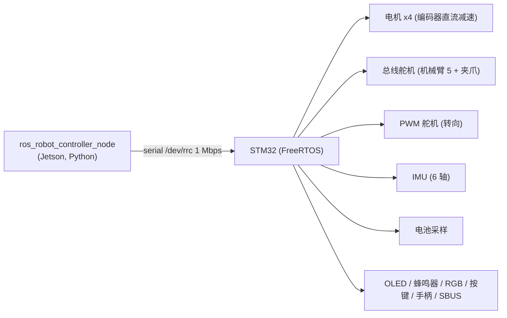

# hardware · 硬件通信（Jetson ↔ STM32）

## 1. 拓扑



设备名来自 udev 规则 `src/driver/ros_robot_controller/scripts/99-ttyACM0.rules`，
SDK 默认 `device="/dev/rrc"`（`ros_robot_controller_sdk.py:98`）。

## 2. 帧格式（A 级，收发两侧一致）

```
AA 55 | FUNC | LEN | DATA... | CRC8
```

* `FUNC`：1 字节功能码（见下表）
* `LEN`：`DATA` 长度
* `CRC8`：对 `[FUNC, LEN, DATA...]` 查表计算（`checksum_crc8`，表在 `sdk.py:48-65`）

> 注意：`sdk.py:13` 的协议注释写的是 `AA 55 Length Function ID Data Checksum`，
> 与实现（先 FIFO 再 LEN）不一致。**以实现为准**，注释是旧的。

### 功能码

| 值 | 名称 | 方向 | 说明 |
|---|---|---|---|
| 0 | SYS | 双向 | 电池等系统数据（子命令 0x01 设阈值、0x04 上报） |
| 1 | LED | 下发 | 闪烁参数 |
| 2 | BUZZER | 下发 | 频率/响停时间/次数 |
| 3 | MOTOR | 下发 | 子命令 0x01 设速度、0x05 设电机类型 |
| 4 | PWM_SERVO | 双向 | 子命令 0x03 位置、0x07 偏移、读位置/偏移 |
| 5 | BUS_SERVO | 双向 | 位置/ID/偏移/限位/电压/温度/扭矩 |
| 6 | KEY | 上报 | 按键事件（8 种） |
| 7 | IMU | 上报 | 6 × float32（ax,ay,az,gx,gy,gz） |
| 8 | GAMEPAD | 上报 | `<HB4b`：按键位、hat、两摇杆 |
| 9 | SBUS | 上报 | 16 通道 + 17/18 + 失控标志 |
| 10 | OLED | 下发 | 行号 + 文本 |
| 11 | NONE | — | 边界值 |

### 电机载荷

```python
data = [0x01, len(speeds)]
for (mid, rps) in speeds:
    data += struct.pack("<Bf", int(mid - 1), float(rps))
```

→ STM32 收到的 ID 是 **0 基**，rps 是 IEEE754 小端 float。

## 3. 节点行为

`ros_robot_controller_node.py`：

| 方向 | 话题 | 处理 |
|---|---|---|
| 下发 | `~/set_motor` | `set_motor_state` → `board.set_motor_speed` |
| 下发 | `~/bus_servo/set_position` | `set_bus_servo_position` → 总线舵机 |
| 下发 | `~/pwm_servo/set_state` | 位置 + 偏移 |
| 下发 | `~/set_led` / `set_buzzer` / `set_oled` / `set_rgb` | 外设 |
| 上报 | `~/imu_raw` | 无姿态四元数（全 0），加速度 ×9.80665，角速度 deg/s→rad/s |
| 上报 | `~/battery` | `UInt16`，见下 |
| 上报 | `~/joy` `~/sbus` `~/button` | 输入设备 |
| 服务 | `~/bus_servo/get_state`、`~/pwm_servo/get_state` | 读舵机状态 |

上报由一个**独立线程**按 50 Hz 轮询队列（`pub_callback`），只有 `enable_recv` 为真时工作。

### 关于电池单位

* `get_battery()` 注释写"获取电压，单位 mAh"——**自相矛盾**，不可信。
* 同文件 `set_battery_level(battery_level=0x2904)`：`0x2904 = 10500`，符合 3S 锂电 10.5 V 欠压点，
  **推断单位为 mV**（B 级证据）。
* 实机用万用表对比一次即可定论。

### 关于舵机偏移

`load_servo_offsets()` 读取 `/home/ubuntu/software/Servo_upper_computer/servo_config.yaml`：

* 该文件**不在源码包内**，由上位机软件生成；
* 文件缺失只打日志，不阻止启动（`except FileNotFoundError`）；
* 只处理 ID 1–4（PWM 舵机），总线舵机偏差走 `bus_servo_set_offset`。

## 4. 初始化握手

`~/init_finish` 服务被大量节点用于"等对方起来"：

| 节点 | 等待谁 | 证据 |
|---|---|---|
| `controller_manager` | `/ros_robot_controller/init_finish` | `controller_manager.py:57-58` |
| `search_kinematics_solutions` | `/controller_manager/init_finish` | `search_kinematics_solutions_node.py:33-34` |
| `init_pose` | `/controller_manager/init_finish` | `init_pose.py:24-25` |

这是原厂唯一的"启动顺序控制"手段：**服务存在 ≠ 设备就绪**，只代表进程起来了。

## 5. 缺陷与风险

| # | 问题 | 证据 | 后果 |
|---|---|---|---|
| 1 | 无通信超时/重试 | `recv_task` 无限循环，校验失败只 `print("校验失败")` | 串口异常时静默丢帧 |
| 2 | 无电机看门狗 | `set_motor_state` 直接转发 | 上游停了，电机是否停取决于 STM32（未知） |
| 3 | `enable_reception` 属性遮蔽 | `pub_callback` 用 `getattr(self,'enable_reception',False)`，初始拿到的是**方法对象**（真值） | 上报线程一开始就在跑，直到收到第一条 Bool 才变成真实开关 |
| 4 | 舵机 PID 设置被注释 | `__init__` 第 60 行 `# self.set_arm_sero_pid()` | 出厂不做 PID 整定 |
| 5 | 偏移文件路径硬编码 | `ros_robot_controller_node.py:95` | 换机/换用户即失效 |
| 6 | 串口独占 | 一个 `Board()` 一个设备 | 第二个进程打开 `/dev/rrc` 会失败 |

## 6. 复用建议

* **直接复用**：`ros_robot_controller_node.py` + `ros_robot_controller_sdk.py`（协议稳定、注释齐全）。
* 修改后复用：补一个"指令超时→零速"的守护，放在节点内部或上游仲裁器。
* 不要修改串口帧格式——STM32 固件闭源，改了没有对端。
