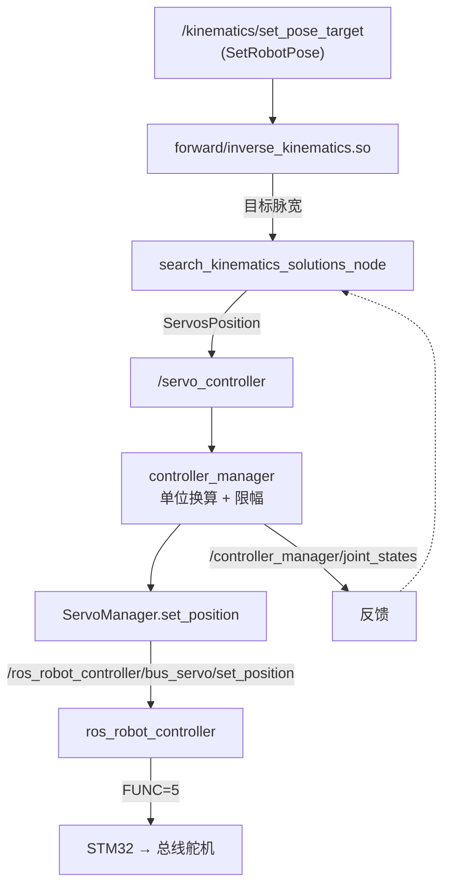

# manipulation · 机械臂

## 1. 硬件与自由度

| 项 | 内容 | 证据 |
|---|---|---|
| 关节 | 5 个总线舵机（joint1–joint5）+ 夹爪（r_joint，ID 10） | `controller_manager.py:24`、`init_pose.py:41` |
| 关节模型 | `link1..link5`、`gripper_link`、`l_link`/`r_link`（左右指） | `rosorin_description/urdf/pro/arm.urdf.xacro` |
| 位置单位 | 脉宽 0–1000，中位 500 | `servo_controller.py:59-60` |
| 通信 | 总线舵机经 STM32 转发（FUNC=5） | `hardware.md` |

## 2. 控制链



证据：`kinematics_control.py`、`search_kinematics_solutions_node.py:30-60`、
`controller_manager.py:47-112`、`servo_controller.py:54-66`。

## 3. 服务接口（`kinematics_msgs`）

| 服务 | 类型 | 作用 |
|---|---|---|
| `/kinematics/set_pose_target` | `SetRobotPose` | 给 (x,y,z,pitch) 求逆解 |
| `/kinematics/get_current_pose` | `GetRobotPose` | 当前末端位姿 |
| `/kinematics/set_joint_value_target` | `SetJointValue` | 给关节角求正解 |
| `/kinematics/set_link` / `get_link` | `SetLink` / `GetLink` | 设置/读取连杆参数 |
| `/kinematics/set_joint_range` / `get_joint_range` | `SetJointRange` / `GetJointRange` | 关节限位 |

`SetRobotPose` 还支持 `pitch_range` 与 `resolution`：目标俯仰角无解时在范围内搜索（`kinematics_control.py:8-22`）。

## 4. 闭源部分

```
forward_kinematics.so   1,020,240 B
inverse_kinematics.so     755,424 B
```

* 被 `search_kinematics_solutions_node.py:16-17` 直接 import；
* 仓库内**没有任何 C/C++ 源码**对应它们；
* 能看到的只有 `transform.py`（连杆几何常量）与服务接口。

> 结论：机械臂的数学核心不可读、不可改。课题组若要自己做 IK，必须重写这一层；
> 好在接口（服务）是清楚的，可以按同样的服务契约替换实现。

## 5. 舵机管理细节

`controller_manager.py`：

1. 从参数读取每个关节的 `id`，构建 `JointPositionController`；
2. 订阅 `/servo_controller`（`ServosPosition`），支持三种单位：
   * `pulse`：直接下发；
   * `rad` / `deg`：经 `pos_rad_to_pulse` 换算；
3. 订阅 `/joint_controller`（`JointState`），按名字映射到关节；
4. 20 ms 周期发布 `/controller_manager/joint_states` 与 `servo_states`。

`servo_controller.py` 再兜一层：`duration` 限制 [0.02, 30]，位置限制 [0, 1000]。

## 6. 初始位姿

`controller/controller/init_pose.py`：

* `type=action`：读取 `~/software/arm_pc/ActionGroups` 下的动作组文件并播放
  （`ActionGroupController`）。**该目录不在源码包内**；
* `type=servo`：直接给 id1–id5 + id10 发脉宽。

`bringup` 默认拉起 `init_pose`（`bringup.launch.py:52-59`），所以开机机械臂会动——调试时要注意。

## 7. 抓取示例的成熟度

| 示例 | 能力 | 依赖 |
|---|---|---|
| `example/rgbd_function/track_and_grab.py` | 颜色追踪 + 深度测距 + IK 抓取 | 相机内参、硬编码手眼 |
| `openclaw_controller/claw_track_and_grab` | 追踪 + 抓取 + 放置 + 状态查询 | kinematics、controller_manager |
| `large_models_examples/.../vllm_track_arm.py` | 大模型触发追踪抓取 | 同上 |
| `test_stand/llm_control_servo.py` | 单舵机控制测试 | 测试架 |

共同点：**手眼关系靠预设位姿和人工调参**，没有标定文件、没有误差补偿。

## 8. 已知问题

| # | 问题 | 证据 |
|---|---|---|
| 1 | 正逆解闭源 | `*.so` |
| 2 | 动作组目录在仓库外 | `init_pose.py:34` |
| 3 | `kinematics_control.py` 的 `__main__` 示例不可运行（`self`/`node` 未定义） | 第 41-49 行 |
| 4 | 无碰撞检测、无关节限位校验（限位靠舵机固件） | — |
| 5 | 夹爪力控缺失，只有位置 | `servo_controller.py` |

## 9. 复用建议

* 复用：`servo_controller` 整条链、`kinematics_msgs` 服务契约、URDF 模型。
* 重写：IK/FK（若要可维护）、抓取位姿生成、手眼标定。
* 注意：`init_pose` 会在开机时动机械臂，课题组模式应默认关闭。
