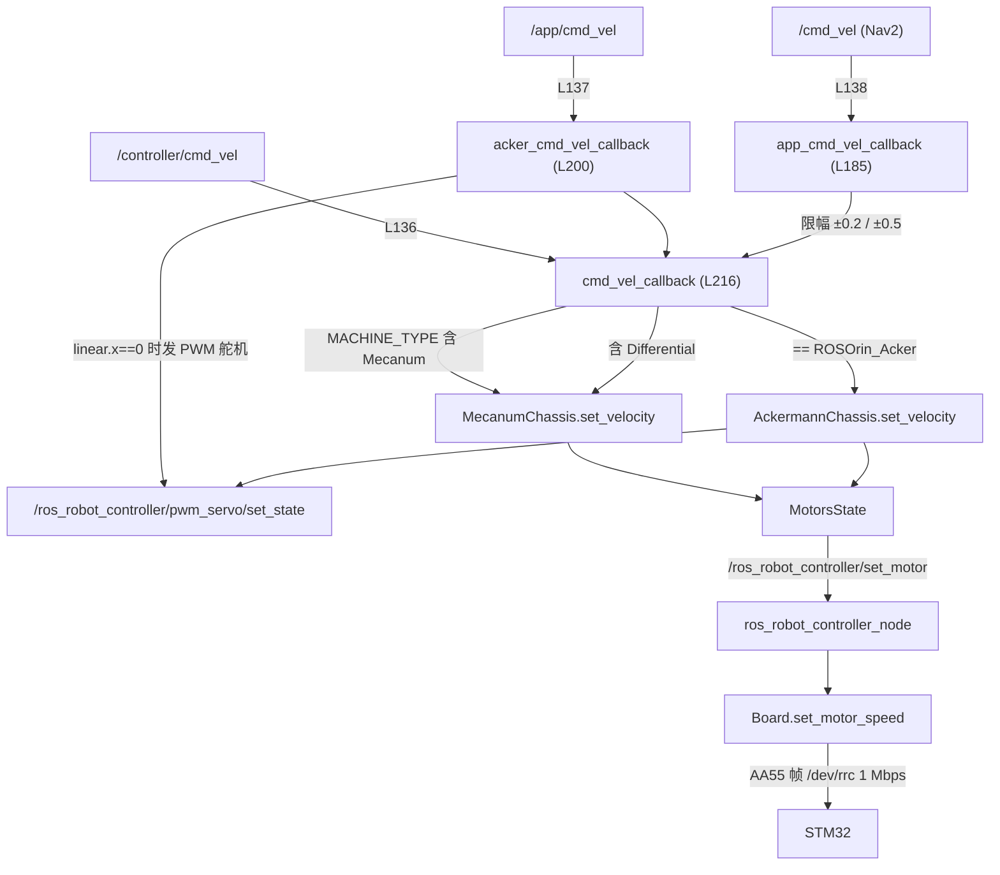

# motion · 底盘运动控制

> 本文件已按源码重新逐行核对（`odom_publisher_node.py` 298 行全文重读）。
> 上一版把三个入口都画成进入 `cmd_vel_callback`，**是错的**，本次修正。

## 1. 三个入口 → 三个回调（逐行核实）

`src/driver/controller/controller/odom_publisher_node.py:135-138`：

| 行号 | 订阅话题 | 回调函数 | 回调定义 | 行为 |
|---|---|---|---|---|
| 135 | `set_odom` (`Pose2D`) | `set_odom` | L162 | 重置里程计位姿 |
| 136 | `controller/cmd_vel` | **`cmd_vel_callback`** | L216 | 直接进运动学，**无限幅** |
| 137 | `app/cmd_vel` | **`acker_cmd_vel_callback`** | L200 | 先做阿克曼/舵机换算，再调 `cmd_vel_callback` |
| 138 | `cmd_vel` | **`app_cmd_vel_callback`** | L185 | 先限幅，再调 `cmd_vel_callback` |

> 命名具有误导性：`acker_cmd_vel_callback` 挂的是 `/app/cmd_vel`，
> `app_cmd_vel_callback` 挂的是 `/cmd_vel`。以**订阅行为准**，不要按函数名推断。

## 2. 完整链路



## 3. 三个回调的实际代码（摘录）

### 3.1 `app_cmd_vel_callback`（`/cmd_vel`，L185-198）

```python
if msg.linear.x > 0.2:  msg.linear.x = 0.2
if msg.linear.x < -0.2: msg.linear.x = -0.2
if msg.linear.y > 0.2:  msg.linear.y = 0.2
if msg.linear.y < -0.2: msg.linear.y = -0.2
if msg.angular.z > 0.5:  msg.angular.z = 0.5
if msg.angular.z < -0.5: msg.angular.z = -0.5
self.cmd_vel_callback(msg)
```

唯一的限幅入口。Nav2 的 `velocity_smoother` 正是 remap 到 `/cmd_vel`
（`navigation/launch/include/navigation_base.launch.py`：`cmd_vel_smoothed → cmd_vel`），
所以**导航速度上限被这里写死为 0.2 m/s、0.5 rad/s**，与 `nav2_params.yaml` 无关。

### 3.2 `acker_cmd_vel_callback`（`/app/cmd_vel`，L200-214）

```python
if msg.linear.x == 0:
    msg.linear.z = 1.0
    servo_state.id = [1]
    servo_state.position = [1500 + int(math.degrees(-msg.angular.z)/180*2000)]
    self.servo_state_pub.publish(data)          # 发 PWM 舵机 1 号
else:
    if msg.angular.z != 0:
        R = 0.17706/math.tan(msg.angular.z)
        msg.angular.z = msg.linear.x/R
self.cmd_vel_callback(msg)
```

两个必须知道的行为：

1. **纯旋转时仍会发舵机指令**。即使机型是麦轮（`ROSOrin_Mecanum_Pro`），
   只要有人往 `/app/cmd_vel` 发 `linear.x=0, angular.z≠0`，就会先动 PWM 舵机 1 号；
   随后 `cmd_vel_callback` 按麦轮处理，车也会转。等于一条消息触发两个执行器。
2. 在该回调中，非零转向输入时使用硬编码轴距 `0.17706` 与输入 `msg.angular.z`（在这里用作转向角）计算 `R = 0.17706 / tan(msg.angular.z)`，再令 `msg.angular.z = msg.linear.x / R` 得到角速度。**不能把这段实现简写成“用 `R=v/ω` 反算半径”**；与 `ackermann.py` 的轴距参数是否重复需结合构造参数核实。

### 3.3 `cmd_vel_callback`（L216-254）

```python
if self.machine_type != 'ROSOrin_Acker':
    if 'Mecanum' in self.machine_type: ...      # 取 vx, vy, wz
    elif 'Differential' in self.machine_type: ... # 丢弃 vy
    speeds = self.mecanum.set_velocity(...)
    self.motor_pub.publish(speeds)
elif self.machine_type == 'ROSOrin_Acker':
    ...
    speeds = self.ackermann.set_velocity(...)
    self.motor_pub.publish(speeds[1])
    if speeds[0] is not None: 发 PWM 舵机
```

* 电机控制输出至 `/ros_robot_controller/set_motor`（`MotorsState`）；**Ackermann分支还可能发布PWM舵机控制消息**，不能称“只有一个输出话题”。
* 麦轮固定 4 个电机；阿克曼只有 2、4 号电机（`v_s = [0, vl, 0, -vr]`）。
* 每次回调直接 publish，**没有节流**：上游发多快就发多快。

## 4. 麦轮运动学（`mecanum.py:25-60`）

```python
motor1 = vx - vy - wz*(L+W)/2
motor2 = vx + vy - wz*(L+W)/2
motor3 = vx + vy + wz*(L+W)/2
motor4 = vx - vy + wz*(L+W)/2
v_s = [cvt(m1), cvt(m2), -cvt(m3), -cvt(m4)]   # 3、4 取负
cvt(v) = v / (π * wheel_diameter)               # m/s → rps
```

### 参数陷阱（重新核实）

| 位置 | wheelbase | track_width | wheel_diameter |
|---|---|---|---|
| `mecanum.py:11` 默认值 | 0.206 | 0.194 | **0.0065** |
| `odom_publisher_node.py:105` 实际传参 | 0.17706 | 0.17165 | **0.08** |

默认值（尤其 0.0065）疑似 `0.065` 笔误，但节点构造时显式覆盖，**实际不使用**。
直接 `MecanumChassis()` 会得到错误结果。

## 5. 里程计（`cal_odom_fun`，L256-290）

```python
delta_x   = linear_x * dt * cos(yaw)
delta_y   = linear_x * dt * sin(yaw)
delta_yaw = angular_z * dt
pose.x = linear_factor * x ; pose.y = linear_factor * y
```

* **只用 `linear_x` 积分**；`linear_y` 仅出现在 `twist.twist.linear.y`，不参与位置。
* 独立线程 `time.sleep(0.02)`，不是 ROS timer；无退出条件。
* 静止时切换协方差，给 EKF 更强约束。
* **无编码器反馈**：`/odom_raw` 是指令积分，不是轮速积分。

## 6. 已知缺陷（更新）

| # | 问题 | 位置 | 说明 |
|---|---|---|---|
| 1 | 三入口无仲裁 | L136-138 | 最后一条消息胜出 |
| 2 | 仅 `/cmd_vel` 限幅 | L185-198 | 其余入口无限幅 |
| 3 | 横移不积分 | L266-272 | 麦轮横移位置估计不变 |
| 4 | 纯旋转触发 PWM 舵机 | L200-209 | 麦轮机型也会执行 |
| 5 | 参数名带 `~` | L153-156 | 调用标定服务可能抛 `ParameterNotDeclaredException`（C 级） |
| 6 | 默认几何参数错误 | `mecanum.py:11` | 直接实例化错 10 倍 |
| 7 | 无指令超时 | 全文 | 上游停发后底盘行为取决于 STM32 |

## 7. 复用建议

* **可复用**：`mecanum.py` / `ackermann.py` 的公式，参数外置。
* **不要复用**：`odom_publisher_node.py` 的三入口结构与 odom 积分。
* 若沿用原厂节点，至少：只保留 `/controller/cmd_vel` 一个入口、给 odom 补 `linear_y`、
  在入口前加仲裁与超时。
