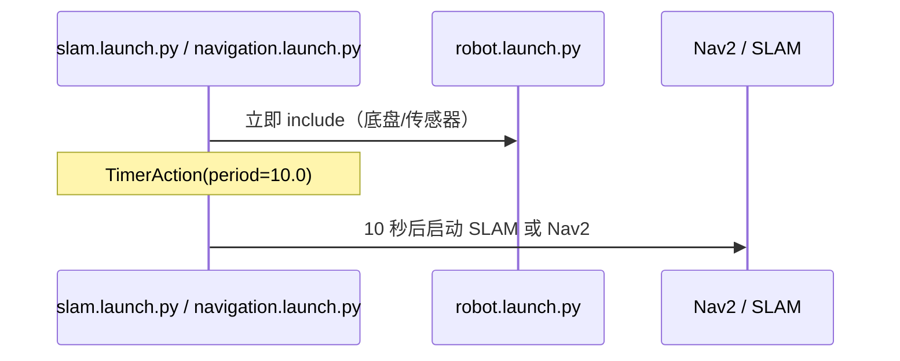
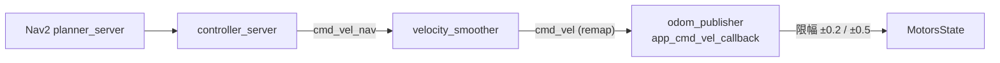

# navigation · SLAM 与自主导航

## 1. 组成

| 部分 | 位置 | 说明 |
|---|---|---|
| 2D SLAM | `slam/launch/slam.launch.py` | 默认 `slam_toolbox`，可选 cartographer / gmapping / rrt_explorer |
| 3D SLAM | `slam/launch/rtabmap_slam.launch.py` | RTAB-Map（依赖 `rtabmap_ws`） |
| 定位 | `navigation/launch/include/localization.launch.py` | AMCL + map_server |
| 导航 | `navigation/launch/navigation.launch.py` | Nav2（planner/controller/bt_navigator…） |
| 参数 | `navigation/config/nav2_params.yaml` | 另有 `nav2_controller_teb.yaml`、`nav2_controller_dwb.yaml` |
| 导航封装 | `large_models_examples/.../navigation_controller.py` | `nav2_simple_commander` 封装，提供 `/set_pose` |

## 2. 启动顺序



* 都用 `TimerAction(period=10.0)` 硬等 10 秒（`navigation.launch.py:60-63`、`slam.launch.py`）。
* 没有"等 /scan 有数据"之类的就绪判断。

## 3. TF 与坐标系

```
map ──(AMCL/SLAM)──► odom ──(EKF)──► base_footprint ──► laser_frame / depth_cam_* / imu_link
```

* `frame_prefix` 支持多机（`robot_name` ≠ `/` 时加前缀）。
* `HOST` / `MASTER` 来自 `.typerc`，默认 `/`（单机）。
* EKF 配置 `two_d_mode: true`，`world_frame: odom`，输入 `odom_raw` + `imu`。

## 4. 速度链路（关键）



证据：`navigation/launch/include/navigation_base.launch.py` 中
`remappings + [('cmd_vel','cmd_vel_nav'), ('cmd_vel_smoothed','cmd_vel')]`。

**这意味着**：Nav2 实际走的是 `/cmd_vel` 入口，被 `odom_publisher_node.py:185-198` 限幅，
上限 0.2 m/s、0.5 rad/s。改 `nav2_params.yaml` 里的 `max_vel_x` 不会突破这个上限。

## 5. 地图

* 路径：`slam/maps/<name>.yaml + .pgm`；
* 保存：`command` 第 149 行用 `nav2_map_server map_saver_cli`；
* `slam/slam/map_save.py` 提供 `/slam_toolbox/save_map` 的服务封装；
* navigation 默认 `map_01`。

地图文件不在本快照中（`slam/maps/` 被 `.gitignore` 忽略：`src/slam/maps/*`）。

## 6. 已知问题

| # | 问题 | 证据 | 影响 |
|---|---|---|---|
| 1 | 硬等 10 秒 | `navigation.launch.py:60` | 慢机器上 Nav2 起不来 / 快机器上白等 |
| 2 | 导航封装不在 navigation 包 | `large_models_examples/navigation_controller.py` | 包职责混乱，依赖示例包 |
| 3 | 两套参数（teb/dwb）靠 launch 参数切换 | `use_teb` | 参数文件与控制器不匹配时静默用默认 |
| 4 | 无代价地图传感器标定 | — | 雷达安装角/高度需人工确认 |
| 5 | 无恢复行为定制 | 用 Nav2 默认 | 卡住时行为不可控 |

## 7. 复用建议

* **复用**：Nav2 本体与参数文件（作为起点）、SLAM launch 结构、TF 约定。
* **修改**：把 10 秒硬等改成"等 `/scan` + `/odom` 就绪"；把导航输出接到课题组仲裁器而不是 `/cmd_vel`。
* **不要复用** `navigation_controller.py` 的 `BasicNavigator` 封装（阻塞式、无取消）。
