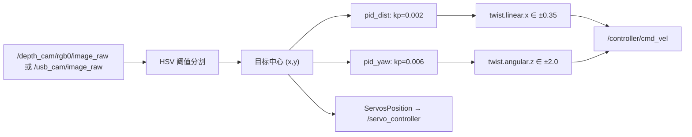

# perception · 视觉感知

## 1. 代码分布

| 位置 | 内容 | 性质 |
|---|---|---|
| `app/app/line_following.py` | 颜色巡线（PID 控速+转向） | 产品应用 |
| `app/app/object_tracking.py` | 颜色目标追踪（PID） | 产品应用 |
| `app/app/lidar_controller.py` | 雷达避障/跟随/警卫 | 产品应用（非视觉） |
| `app/app/model/*.onnx` | 手掌检测/关键点（MediaPipe 模型） | 模型 |
| `example/example/yolo_detect/` | YOLO TensorRT 检测 | 教学示例 |
| `example/example/mediapipe_example/` | 8 个人体/手势 demo | 教学示例 |
| `example/example/rgbd_function/` | RGB-D 三维抓取 | 教学示例 |
| `example/example/color_detect/` | 颜色/二维码 | 教学示例 |

## 2. 两条典型视觉链路

### 2.1 颜色追踪（产品级）



证据：`app/app/object_tracking.py:29-30,103-117,146-155`。

特点：

* PID 只有 P（`kp`），没有 I/D；
* 输出限幅写死在代码里（±0.35 m/s、±2.0 rad/s），**比导航路径的 ±0.2 更激进**；
* 直接发 `/controller/cmd_vel`，绕过任何仲裁。

### 2.2 YOLO 检测（示例级）

```python
# example/example/yolo_detect/yolo_node.py
self.image_sub = self.create_subscription(Image, '/depth_cam/rgb0/image_raw', self.image_callback, 1)
self.object_pub = self.create_publisher(ObjectsInfo, '~/object_detect', 1)
self.result_image_pub = self.create_publisher(Image, '~/object_image', 1)
```

* 模型：`models/{v11,26}/*.engine`（TensorRT，10 个，最大 38 MB）；
* 参数 `engine` 选模型，`task` 决定检测/分割；
* 输出 `interfaces/ObjectsInfo`（自定义消息，字段见 `interfaces/msg/ObjectsInfo.msg`）；
* **不输出三维坐标**，只有像素框 + 类别 + 置信度。

## 3. 三维坐标计算

全仓库唯一成型的实现是 `example/example/rgbd_function/track_and_grab.py:30-35`：

```python
def depth_pixel_to_camera(pixel_coords, depth, intrinsics):
    fx, fy, cx, cy = intrinsics
    px, py = pixel_coords
    x = (px - cx) * depth / fx
    y = (py - cy) * depth / fy
    z = depth
```

同步方式：

```python
rgb_sub   = message_filters.Subscriber(self, Image, '/depth_cam/rgb0/image_raw')
depth_sub = message_filters.Subscriber(self, Image, '/depth_cam/depth0/image_raw')
info_sub  = message_filters.Subscriber(self, CameraInfo, '/depth_cam/depth0/camera_info')
sync = message_filters.ApproximateTimeSynchronizer([rgb_sub, depth_sub, info_sub], 3, 0.02)
```

注释里保留的"手眼标定"痕迹（`set_servo_position` 预设位姿、固定脉宽）说明：
**手眼矩阵是硬编码在示例里的**，不是标定文件。

## 4. 原厂做不到的事

| 能力 | 状态 | 证据 |
|---|---|---|
| 统一三维目标话题 | ❌ | 每个 demo 各自算、各自用；没有公共 msg |
| 多目标跟踪与 ID 维持 | ❌ | 只有单颜色/单框 |
| 相机内参在线获取 | ⚠️ | 只有 rgbd 示例读 `CameraInfo`，app 里写死阈值 |
| 手眼标定可复现 | ❌ | 矩阵散落在各 demo 代码常量中 |
| 深度图对齐 RGB | ⚠️ | 依赖相机驱动输出，未见显式对齐步骤 |

## 5. 复用建议

* **可复用**：`depth_pixel_to_camera` 思路、`yolo_node` 的 TensorRT 加载方式、`ApproximateTimeSynchronizer` 同步模板。
* **不复用**：`app` 的 PID 追踪（直接写底盘，且参数写死）。
* **必须新建**：统一 `Object3D` 接口 + 标定文件 + 手眼变换（课题组 lab_ws 已有 `lab_msgs/Object3D`）。
